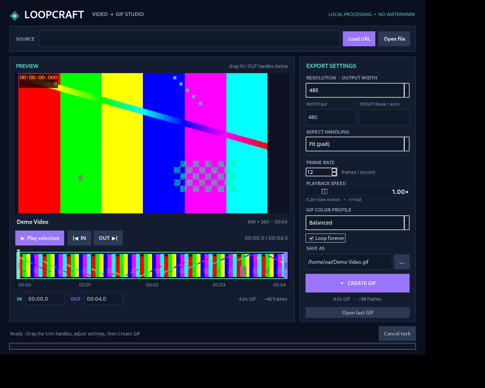

# LoopCraft — YouTube → GIF Studio

A dark desktop GUI for making animated GIFs from **YouTube videos or local video files**. It includes a filmstrip timeline, draggable IN/OUT selection, silent playback preview, speed adjustment, pixel-size selection, crop/pad/stretch modes, frame-rate control, palette optimization, and live export progress.



## Quick start (Windows)

1. Extract the ZIP to a folder.
2. Double-click **`run_loopcraft.bat`**. It installs missing dependencies automatically (requires Python 3.10+ with the `py` launcher).
3. Paste a YouTube URL and click **Load URL**, or click **Open file** to load a local video.
4. Drag the aqua **IN** and purple **OUT** timeline handles. Press **Play selection** to preview.
5. Choose width (320–1080 preset, or enter 32–1920 custom), optional height, FPS, playback speed, color profile, and output file.
6. Click **CREATE GIF**.

If you prefer the command line:

```powershell
py -m pip install --upgrade yt-dlp pillow imageio-ffmpeg
py loopcraft.py
```

An official Windows Python installation normally includes tkinter. No MoviePy or separately-installed FFmpeg is needed: `imageio-ffmpeg` supplies the FFmpeg executable when one is not already on PATH. **YouTube extraction still depends on yt-dlp working with the requested link.** If a video stops downloading, update it with `py -m pip install -U yt-dlp`.

## Controls

| Action | How |
|---|---|
| Select beginning and end | Drag timeline handles, or type IN and OUT in `MM:SS`, `HH:MM:SS`, or seconds |
| Scrub video | Click or drag in the timeline |
| Preview selected section | Click **Play selection** or press Space outside a text box |
| Move one-half second | Left / Right arrow (when not typing) |
| Move five seconds | Shift + Left / Right arrow |
| Open local file | Ctrl + O |
| Export GIF | Ctrl + Enter |
| Fast/slow motion | Set Playback Speed between 0.25× and 4× |
| Control output size | Enter width; leave height blank for automatic aspect ratio, or enter a height |
| Output exact width and height | Select Fit (pad), Fill (crop), or Stretch |
| Reduce file size | Lower resolution, shorten duration, reduce FPS, try Smaller file color profile |
| Loop infinitely | Check **Loop forever** |
| Stop download/export | Click **Cancel task** |

## How it works and limitations

- **YouTube import downloads a video-only copy up to 1080p** so timeline thumbnails and preview can be generated locally. It downloads the *whole source video*, not just the selected portion. Very long YouTube videos may require time and disk space. The original source is not transcoded until export.
- **Local videos** are used directly without a copy.
- Preview is **silent**; GIFs have no audio track.
- Output is made with **FFmpeg's two-pass `palettegen` / `paletteuse` filters** for a more accurate GIF color palette.
- GIFs support at most 256 colors per frame; high-resolution, long animations can be large. A warning appears for long or high-frame-count exports.
- Downloading may fail for private, geoblocked, DRM-protected, or otherwise unavailable YouTube videos. Download only content you have permission to use.
- No login account, cloud upload, web service, or watermark is required. The source is processed on your computer after download.

Dependencies: Python 3.10+, Pillow, yt-dlp, imageio-ffmpeg; tkinter is provided by the normal Windows Python installer.
